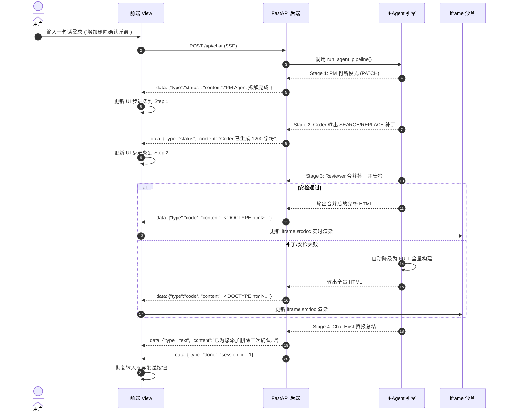

# Prompt2App 前后端需求与交互规格说明书 (REQUIREMENTS_SPEC.md)

## 1. 项目概述与交付红线

### 1.1 项目目标
Prompt2App 目标是提供一个类似于 Atoms.dev 的 AI 驱动 Web 应用生成工作台。用户只需输入一句话自然语言需求，系统通过多 Agent 协作拆解需求、编写代码、独立审查安检并流式合并，在右侧沙盒中即时运行生成单文件 HTML 应用。

在视觉与交互维度，系统全面对标 Atoms.dev：
* **`/zh/` (灵感启动台)**：Hero 唤起区 + 预置案例广场。
* **`/zh/dashboard` (个人资产库)**：历史应用管理与云端同步状态。
* **`/zh/chat/:id` (多 Agent 协作工作台)**：左侧侧边栏 + 中间 Agent 对话流 + 右侧沙盒预览区。

---

### 1.2 笔试通过一票否决红线（硬规矩）
1. **国内直连 & 无痕可开**：
   * 服务必须监听在 `0.0.0.0`，端口优先读取 `os.environ.get("PORT", 8000)`，严禁硬编码 `localhost`。
2. **冷打开绝不空白**：
   * 数据库启动时必须自动注入 4 个高质量可交互预置应用（房贷计算器、待办看板、个人主页、番茄钟），未登录游客首次进入即可点击预览与交互。
3. **四层容灾防崩保命**：
   * 即使无 API Key、网络中断或上游模型 429 限流，系统绝不返回 500 或出现白屏，自动触发 L4 离线模板库，并显著标明 `【演示模式】`。
4. **迭代防破坏铁律**：
   * 对已有应用进行局部修改时，优先使用 `SEARCH/REPLACE` 增量补丁；若合并或安检失败，系统自动回滚并保留上一版可用代码。

---

## 2. 数据库与持久化设计 (`database.py`)

使用 Python 内置 `sqlite3` 数据库（数据库文件 `app.db`），开启 WAL 模式与外键约束。

### 2.1 表结构定义 (Schema)

```sql
-- 1. 用户表
CREATE TABLE IF NOT EXISTS users (
    id INTEGER PRIMARY KEY AUTOINCREMENT,
    username TEXT NOT NULL UNIQUE,
    password_hash TEXT NOT NULL,
    created_at TEXT NOT NULL
);

-- 2. 鉴权 Token 表
CREATE TABLE IF NOT EXISTS tokens (
    token TEXT PRIMARY KEY,
    user_id INTEGER NOT NULL,
    expires_at TEXT NOT NULL,
    created_at TEXT NOT NULL,
    FOREIGN KEY (user_id) REFERENCES users(id)
);

-- 3. 会话表 (user_id = 0 代表公共广场预置模板)
CREATE TABLE IF NOT EXISTS sessions (
    id INTEGER PRIMARY KEY AUTOINCREMENT,
    user_id INTEGER NOT NULL,
    title TEXT NOT NULL,
    latest_code TEXT,
    is_public INTEGER NOT NULL DEFAULT 0,
    created_at TEXT NOT NULL,
    updated_at TEXT NOT NULL,
    FOREIGN KEY (user_id) REFERENCES users(id)
);

-- 4. 对话消息表 (不保存完整 HTML 源码)
CREATE TABLE IF NOT EXISTS messages (
    id INTEGER PRIMARY KEY AUTOINCREMENT,
    session_id INTEGER NOT NULL,
    role TEXT NOT NULL CHECK (role IN ('user', 'assistant', 'status')),
    agent TEXT,
    content TEXT NOT NULL,
    created_at TEXT NOT NULL,
    FOREIGN KEY (session_id) REFERENCES sessions(id)
);

-- 5. 应用版本快照表 (支持版本回滚与审计)
CREATE TABLE IF NOT EXISTS app_versions (
    id INTEGER PRIMARY KEY AUTOINCREMENT,
    session_id INTEGER NOT NULL,
    code TEXT NOT NULL,
    mode TEXT NOT NULL CHECK (mode IN ('FULL', 'PATCH', 'FALLBACK')),
    note TEXT,
    created_at TEXT NOT NULL,
    FOREIGN KEY (session_id) REFERENCES sessions(id)
);
```

### 2.2 4 个冷启动预置种子应用 (Seed Data)
数据库初始化函数 `init_db()` 执行时，若检查到 `sessions` 表中 `is_public = 1` 的记录为 0，自动写入以下 4 个完整、无外部阻断依赖的单文件 HTML 应用：

1. **《智能房贷计算器（支持提前还款对比）》**：
   * 包含等额本息 / 本金切换、LPR 利率调整、提前还款金额与缩期/缩额对比计算及数据图表展示。
2. **《项目管理待办看板（支持优先级与状态切换）》**：
   * 包含 待办/进行中/已完成 三列卡片拖拽与状态流转、高/中/低优先级筛选及 `localStorage` 本地存储。
3. **《极简程序员个人主页》**：
   * 包含个人 Skill 雷达图、项目卡片展示、深浅色主题一键切换与联系方式复制交互。
4. **《专注番茄钟与任务计时器》**：
   * 包含 25min 专注与 5min 短休倒计时、SVG 动态环形进度条、Web Audio 音效提示及今日统计。

---

## 3. 后端 API 契约与接口设计 (`main.py`)

所有同步 `sqlite3` 查询均须经 `await asyncio.to_thread(...)` 包装，防止阻塞异步事件循环。

### 3.1 REST API

#### 1. 服务健康检查
* **`GET /api/health`**
* **响应**：`{"ok": true, "version": "1.0.0"}`

#### 2. 注册登录合一接口
* **`POST /api/login`**
* **请求体**：
  ```json
  {
    "username": "demo_user",
    "password": "password123"
  }
  ```
* **业务逻辑**：
  * 若用户名不存在，自动创建新用户（密码通过 `PBKDF2-HMAC-SHA256` 加盐哈希处理）并颁发 Token。
  * 若用户名已存在，校验密码；正确则返回 Token，错误则返回 HTTP 401。
* **响应**：
  ```json
  {
    "token": "secure_token_string",
    "username": "demo_user"
  }
  ```

#### 3. 公共广场应用列表（免登录）
* **`GET /api/public/showcase`**
* **响应**：
  ```json
  [
    {
      "id": 1,
      "title": "智能房贷计算器",
      "latest_code": "<!DOCTYPE html>...",
      "updated_at": "2026-11-22 18:00:00"
    }
  ]
  ```

#### 4. 获取用户会话列表
* **`GET /api/sessions`**
* **请求头**：`Authorization: Bearer <token>` (可选)
* **业务逻辑**：传入有效 Token 则返回该用户的私有项目列表；游客未传 Token 则返回公共广场列表。

#### 5. 获取指定会话详情
* **`GET /api/sessions/{session_id}`**
* **响应**：
  ```json
  {
    "id": 1,
    "title": "项目管理待办看板",
    "is_public": 1,
    "messages": [
      {
        "role": "user",
        "agent": null,
        "content": "做一个带优先级的待办看板"
      },
      {
        "role": "assistant",
        "agent": "host",
        "content": "已为您构建完成，右侧可直接预览。"
      }
    ],
    "latest_code": "<!DOCTYPE html>...",
    "versions": [
      {
        "id": 10,
        "mode": "FULL",
        "note": "全量构建完成",
        "created_at": "2026-11-22 18:05:00"
      }
    ]
  }
  ```

#### 6. 版本一键回滚
* **`POST /api/sessions/{session_id}/versions/{version_id}/restore`**
* **业务逻辑**：校验权限后，将 `app_versions` 中对应 `version_id` 的代码写回 `sessions.latest_code`，并追加一条新的恢复快照。

---

### 3.2 SSE 流式生成接口 (`POST /api/chat`)

* **请求头**：`Authorization: Bearer <token>`
* **请求体**：
  ```json
  {
    "session_id": 1,
    "message": "在待办看板中增加一个导出 JSON 的按钮"
  }
  ```
* **写保护与自动 Fork 机制**：
  * 若用户尝试对公共预置项目 (`is_public = 1`) 发起修改指令，后端会自动 **Fork** 该项目为该用户的新私有会话（游客自动分配至隔离临时空间），避免公共模板被篡改。
* **SSE 事件流格式** (`Content-Type: text/event-stream`)：
  ```text
  data: {"type": "status", "content": "🧠 [1/4] PM Agent 正在拆解开发需求..."}

  data: {"type": "status", "content": "⚡ [2/4] Coder Agent 正在执行增量补丁 (PATCH)..."}

  data: {"type": "code", "content": "<!DOCTYPE html>..."}

  data: {"type": "text", "content": "已为您添加导出 JSON 按钮，点击即可下载当前看板数据。"}

  data: {"type": "done", "session_id": 12}
  ```

---

## 4. 前端交互与视觉规格 (`static/index.html`)

前端采用 **单文件 HTML + Tailwind CSS + Alpine.js** 架构。

### 4.1 信息架构与对标视图

系统在前端实现 3 个核心视图的无缝切换：

| 视图 | 对标 Atoms.dev | 布局与功能职责 |
| :--- | :--- | :--- |
| **视图 A：灵感启动台** | `https://atoms.dev/zh/` | Hero 标题唤起区 + 多行 Prompt 输入框 + 快捷标签 + 4 个预置应用展示卡片网格。 |
| **视图 B：项目工作台** | `https://atoms.dev/zh/dashboard` | 个人历史项目卡片列表、删除/新建操作、云端同步状态指示器。 |
| **视图 C：多 Agent 协作工作台** | `https://atoms.dev/zh/chat/:id` | **三栏工作台**：左侧 240px 侧边栏，中间 400px 对话流与 4 阶段 Agent 状态卡片，右侧自适应沙盒预览区。 |

---

### 4.2 前端三栏工作台 (视图 C) 详细组件划分

1. **左侧侧边栏 (Sidebar - 240px)**：
   * 顶部「+ 新建应用」按钮。
   * 视图切换标签（灵感首页 / 我的项目）。
   * 历史会话列表（支持高亮当前会话，截断长标题）。
   * 底部账户状态（登录/注册入口或用户名）。

2. **中间对话区 (Chat Flow - 400px)**：
   * 顶部显示当前应用标题与 Agent 协作状态。
   * 消息列表展示用户输入与 Chat Host 回复。
   * **4 阶段 Agent 进度步进器**：
     * `[1/4] PM Agent` 拆解需求
     * `[2/4] Coder Agent` 编写代码（带实时字符数统计）
     * `[3/4] Reviewer` 安全合并
     * `[4/4] Host` 总结汇报
   * 若触发降级，自动高亮渲染 `【演示模式】` 琥珀色卡片。
   * 底部输入框在生成过程中自动转换为红色 **「■ 停止生成」** 按钮，支持前端主动取消请求。

3. **右侧沙盒预览区 (Sandbox Preview - Flexible)**：
   * **顶栏控制条**：
     * 设备视口切换（💻 桌面全宽 / 📱 手机 375px 模式）。
     * 版本历史下拉选框（选择任意版本点击一键恢复）。
     * 「🔄 刷新沙盒」、「🔗 新窗口打开 (Blob URL)」、「📥 下载 HTML 源码」。
   * **运行沙盒**：
     ```html
     <iframe
       id="preview-frame"
       sandbox="allow-scripts allow-forms allow-modals allow-popups"
       class="w-full h-full bg-white border-0"
     ></iframe>
     ```

---

### 4.3 交互逻辑流程图



---

## 5. 多 Agent 流水线与四层防爆引擎 (`agents.py`)

### 5.1 四层容灾降级架构 (L1 ~ L4)

```text
[用户请求]
   │
   ▼
[L1 节流重试] ──(遇到 429 / 5xx 时指数退避重试最多 2 次)
   │
   ▼
[L2 Kimi 主通道] ──(动态调用 GET /v1/models 发现 kimi-k3.1-pro / kimi-k3)
   │ (若无 Key 或调用失败)
   ▼
[L3 备用通道] ──(切换 SiliconFlow / DeepSeek 开源 API)
   │ (若全部在线服务失败)
   ▼
[L4 离线模板库] ──(匹配 SQLite 本地 4 个预置应用，标注【演示模式】出结果)
```

---

### 5.2 独立 Agent 职责划分

1. **PM Agent**：
   * **输入**：用户指令、压缩后的历史摘要、已有代码结构元数据。
   * **职责**：分析意图并输出路由选择 (`FULL` 或 `PATCH`) 及 50 字以内的开发计划 JSON。
2. **Coder Agent**：
   * **输入**：开发计划、路由模式、已有源码。
   * **职责**：`FULL` 模式输出完整 HTML5；`PATCH` 模式输出标准 `SEARCH/REPLACE` 补丁块。
3. **Reviewer / Patcher Agent**：
   * **职责**：采用 Aider 级三层模糊匹配（精确匹配 $\rightarrow$ 行尾空白归一化 $\rightarrow$ 缩进归一化）执行原子替换；进行 HTML 结构闭环与代码缩水校验。
4. **Chat Host Agent**：
   * **职责**：总结生成成果，向用户说明变动亮点；在离线降级时输出 `【演示模式】` 说明。

---

## 6. 部署与验收 Checklist

### 6.1 部署环境规范
* 部署容器或云主机必须支持 **持久化文件系统**，保证 SQLite `app.db` 在服务重启后不丢失。
* Docker 启动命令约束：
  ```bash
  uvicorn main:app --host 0.0.0.0 --port ${PORT:-8000}
  ```

---

### 6.2 提交前自测 Check List

- [ ] **无痕直连测试**：在未登录无痕窗口中打开网址，首屏秒开，且能直接在右侧沙盒中操作预置应用。
- [ ] **数据持久化测试**：注册新用户创建应用，刷新页面或更换浏览器后项目列表与代码依然可恢复。
- [ ] **清 Key 演示测试**：清空 `.env` 中的 API Key，输入新需求，确认不报 500，输出带有 `【演示模式】` 的完整应用。
- [ ] **版本回滚测试**：对应用进行 2 次修改，点击右侧版本下拉框选择初始版本并点击恢复，确认沙盒还原成功。
- [ ] **仓库安全测试**：GitHub 仓库为 Public，且 `.gitignore` 已成功排除 `.env` 和 `*.db`，不泄露任何 Key。